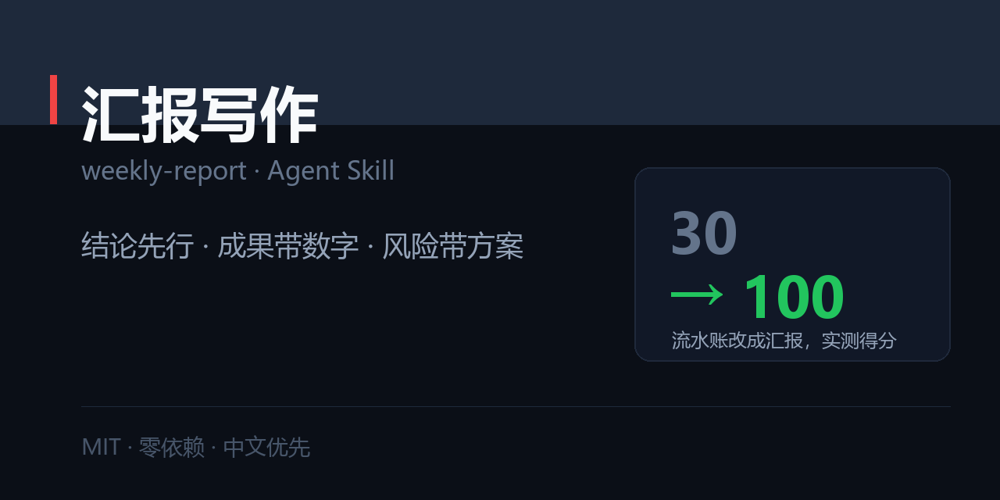

# 汇报写作 · weekly-report

> 周报 / 月报 / 项目汇报 / 复盘 / 述职：结论先行、成果带数字、风险带方案、把「需要什么支持」说清楚。



[](./SKILL.md)
[](./LICENSE)
[](#)

职场五件套之一：[`resume-tailor`](https://github.com/zhbehx/resume-tailor) · [`interview-coach`](https://github.com/zhbehx/interview-coach) · [`weekly-report`](https://github.com/zhbehx/weekly-report) · [`slide-story`](https://github.com/zhbehx/slide-story) · [`meeting-actions`](https://github.com/zhbehx/meeting-actions)

---

## 为什么不是「帮我润色周报」

| | 直接让 AI 润色 | 用这个 Skill |
| --- | --- | --- |
| 输入 | 你的原稿 | 流水账也能进，先做三栏归类（成果/风险/支持） |
| 结构 | 保持你原来的流水账结构 | 强制结论先行 + 成果 ≤3 条 |
| 风险 | 原样保留「供应商延期了」 | 必须补：影响 + 方案 + 需要谁决定 + 最晚何时 |
| 验收 | 读起来顺了 | 脚本打分：无数字条目、弱动词、风险缺方案 |
| 长度 | 越润越长 | 越重要越短，周报一屏 |

核心判断只有一句：**领导读完，知不知道下一步该干什么。**

---

## 安装

```bash
git clone https://github.com/zhbehx/weekly-report.git ~/.claude/skills/weekly-report
```

## 30 秒上手

```
帮我写周报：
- 注册改版上线了，转化率好了一些
- 跟了几个会
- 供应商那边素材晚了
（流水账直接丢进来就行）
```

它会先问一句「给谁看、能不能拿到数据」，拿不到就直接按默认假写出稿，并标注 `假设：…`。

### 你会拿到什么

```markdown
# 一句话状态（进度 + 指标 + 风险 + 需要你决定）
# 本周成果（≤3 条，按影响排序，每条带数字与口径）
# 风险与方案（表格：风险 / 影响 / 我的方案 / 需要你决定）
# 下周计划（≤3 条，带交付物与日期）
# 其他进展（一行带过）
# 自检：数字 X/3 · 弱动词 0 · 风险带方案 ✅ · 一屏 ✅
```

完整示例：[`examples/01-weekly-report.md`](./examples/01-weekly-report.md)（7 条流水账 → **30 分 → 100 分**）

## 自检脚本

零依赖，Python 3.9+：

```bash
python scripts/check_report.py report.md

结论在前 3 行：否
条目数        ：7（无数字 7 条）
弱动词开头    ：5 条
风险条        ：0（缺方案与请求 0 条）
篇幅          ：8 行
评分          ：30/100

必须改：
  - 前 3 行没有结论句（要写清：进度 / 指标 / 风险 / 需要什么决定）
  - 7 条成果没有数字
```

- `--strict` 有严重问题时退出码 1（可挂 pre-commit）
- `--json` 结构化输出
- 结论判定要求「结论词 + 数字」同时出现，避免把「跟进了开发进度」误判成结论

## 核心规则（写在 SKILL.md 里）

1. **结论先行** —— 第一屏一句话：进度 / 风险 / 需要你决定什么。
2. **每条一个成果** —— 做了什么 → 影响到什么 → 下一步。
3. **风险必须带方案** —— 只报问题叫甩锅。
4. **数字优先，口径一致** —— 「转化率」必须写清分子分母。
5. **长度反比于影响力** —— 周报一屏，月报两屏，述职 5 页。

## 仓库结构

```
weekly-report/
├── SKILL.md                      # 五原则 + Step 0–5 + 交付格式 + 反模式
├── references/
│   ├── report-templates.md       # 周报/月报/项目汇报/复盘/述职 5 套 + 结论页 6 种句式
│   └── wording-rules.md          # 动词替换表、五类量化、风险四段式、要支持的公式
├── scripts/
│   └── check_report.py           # 结论位置 / 无数字 / 弱动词 / 风险缺方案 / 篇幅
└── examples/
    └── 01-weekly-report.md       # 流水账 → 汇报（30 → 100）
```

> `market/social-preview.png` 是本仓的社交预览图（1280×640），也用于 README 顶部与分享卡片。改文案后跑 `python ../make_previews.py --only weekly-report` 重新生成。

## 自定义

1. **换公司格式**：把你们的周报模板贴进 `references/report-templates.md`，保留三段骨架。
2. **加指标口径**：在 `wording-rules.md` 里加一节你们公司的指标定义（口径最容易打架）。
3. **改篇幅阈值**：`check_report.py` 顶部 `ONE_SCREEN_LINES = 40`。

## FAQ

**Q：真的没有数据怎么办？**
A：用五类换算（规模/比例/时长/金额/频次），标「约」。一条数字都没有的成果，通常说明这件事还没产出，改成「下周计划」更诚实。

**Q：报风险会不会显得我能力不行？**
A：不会。**报风险 + 带方案**是加分项；不报、等爆了才说才是减分项。脚本会检查你有没有带方案。

**Q：周报要不要写「本周无风险」？**
A：不要。没风险就删掉这一节，写了反而像在占位。

## License

[MIT](./LICENSE)
